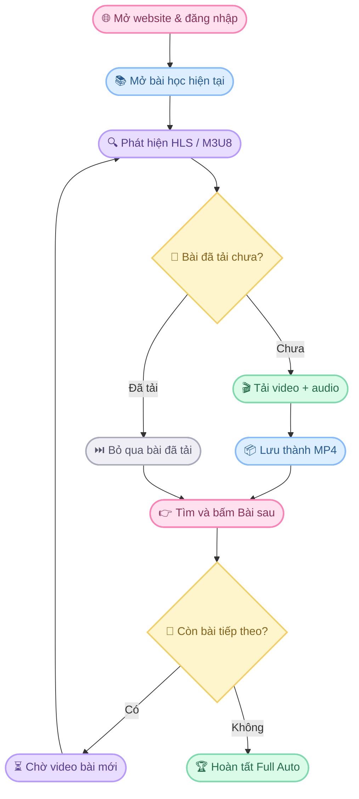

<div align="center">


### ૮꒰ ˶• ༝ •˶꒱ა ♡

**Trợ lý tải bài học tự động — Chỉ một cú nhấn, mọi thứ được xử lý!**

<br/>


<br/>

*✧ Mở bài học · Bấm một nút · Để V4 lo phần còn lại! ✧*

`🌸` ━━━━━━━━━━━━━━━━━━━━━━━━━━━━━━━━━ `🌸`

</div>

## 🎬 Video giới thiệu dự án

<div align="center">

### 🌸 Khám phá Auto Lesson Downloader V4 🌸

*Trình diễn các tính năng tự động tải bài học*

</div>

DÁN_URL_VIDEO_GITHUB_ATTACHMENT_Ở_ĐÂY

<div align="center">

<sub>♡ Auto Lesson Downloader V4 · Happy Learning! ♡</sub>

</div>


## 🌷 01. Mục tiêu

Bạn không cần tải từng bài học một.

Chỉ cần thực hiện 4 bước:

<table>
<tr>
<td align="center">🌐</td>
<td><b>Mở website</b><br/>Truy cập trang học tập.</td>
</tr>
<tr>
<td align="center">🔐</td>
<td><b>Đăng nhập</b><br/>Sử dụng tài khoản của bạn.</td>
</tr>
<tr>
<td align="center">📚</td>
<td><b>Chọn bài học</b><br/>Mở bài muốn bắt đầu tải.</td>
</tr>
<tr>
<td align="center">💗</td>
<td><b>Bấm FULL AUTO TỪ BÀI HIỆN TẠI</b><br/>Để ứng dụng tự động xử lý.</td>
</tr>
</table>

> ૮₍ ˶ᵔ ᵕ ᵔ˶ ₎ა Sau đó V4 sẽ tự động tải bài hiện tại, chuyển bài và tiếp tục tải các bài tiếp theo!

## 🐾 02. V4 hoạt động như thế nào?



## ✨ 03. Tính năng nổi bật

| 🎀 Tính năng | 💬 Mô tả |
|:--|:--|
| 🎬 Phát hiện stream | Tự phát hiện HLS/M3U8 của bài học hiện tại. |
| 🎧 Video + Audio | Tải các thành phần video và audio của stream. |
| 📦 Xuất MP4 | Lưu video thành file MP4. |
| 🐰 Auto Next | Tự tìm và nhấn nút Bài sau. |
| ⏳ Auto Wait | Chờ video bài mới xuất hiện. |
| 🔁 Full Auto | Lặp đến khi không còn nút Bài sau phù hợp. |
| 🔢 Auto Rename | Tự đánh số và đặt tên file theo tiêu đề. |
| 💾 Download History | Ghi nhớ các bài đã tải thành công. |
| ⏭️ Smart Skip | Bỏ qua bài đã tải nếu file vẫn tồn tại. |

## 🌈 04. Rename thứ tự tự động

V4 ưu tiên lấy số bài trực tiếp từ tiêu đề.

**Ví dụ tiêu đề:**

```text
Bài 4: Cấu trúc câu đơn
```

**Tên file được tạo:**

```text
004_Bài 4 - Cấu trúc câu đơn.mp4
```

Nếu tiêu đề không có số bài, V4 sử dụng số thứ tự của phiên Full Auto:

```text
001_...
002_...
003_...
```

Bạn cũng có thể chọn:

`Số thứ tự bắt đầu`

để tùy chỉnh số thứ tự cho phiên tải.

## 💾 05. Bỏ qua bài đã tải

V4 lưu lịch sử tại:

```text
Downloads\AutoLessonAutoSave\history.json
```

Một bài sẽ được bỏ qua khi:

- Bài đó đã được ghi nhận tải thành công.
- File tương ứng vẫn tồn tại trên máy tính.

Nhờ vậy, khi chạy Full Auto lần nữa, ứng dụng không cần tải lại những bài đã hoàn tất và còn file.

## 👉 06. Cấu hình nút Bài sau

Mặc định:


V4 tìm kiếm các phần tử giao diện phổ biến:

```css
button
a
[role="button"]
input[type="button"]
input[type="submit"]
```

Nếu website có selector riêng, bạn có thể nhập vào `Next selector`.

| ⚙️ Cấu hình | 📝 Chức năng |
|:--|:--|
| `Next text` | Nội dung chữ để tìm nút chuyển bài. Mặc định: Bài sau. |
| `Next selector` | CSS selector riêng của nút chuyển bài. |
| `Số thứ tự bắt đầu` | Số bắt đầu khi đánh tên file theo thứ tự phiên tải. |

## 🚀 07. Cài đặt và chạy

### 🩷 Bước 1 — Cài Node.js

Cài đặt **Node.js LTS** trên Windows.


### 💜 Bước 2 — Cài thư viện

Mở PowerShell tại thư mục dự án:

```powershell
npm install
```

### 💙 Bước 3 — Khởi động ứng dụng

```powershell
npm start
```

Hoặc chạy file:

```text
INSTALL_AND_RUN.bat
```

### 💚 Bước 4 — Bắt đầu tải

1. Mở website học tập.
2. Đăng nhập tài khoản.
3. Chọn bài học muốn bắt đầu.
4. Nhấn **FULL AUTO TỪ BÀI HIỆN TẠI**.

`૮꒰ ˶• ༝ •˶꒱ა` Chúc bạn tải bài thành công!

## 📁 08. Cấu trúc thư mục lưu

```text
Downloads/
└── AutoLessonAutoSave/
    ├── 001_....mp4
    ├── 002_....mp4
    ├── 003_....mp4
    └── history.json
```

## 🎧 09. Về âm thanh

Player trên website có thể đang ở trạng thái mute hoặc pause.

Tuy nhiên, file tải trực tiếp vẫn có audio nếu playlist HLS có chứa luồng âm thanh tương ứng.

## ⚠️ 10. Giới hạn và lưu ý

- V4 không lấy khóa, không phá DRM và không vượt protected media.
- Nếu playlist có `#EXT-X-KEY` với phương thức khác `NONE`, ứng dụng sẽ không cố lấy khóa để tải nội dung được bảo vệ.
- Nếu website dùng iframe hoặc cơ chế chuyển bài đặc biệt, selector `Bài sau` có thể cần chỉnh.
- Khả năng tải audio phụ thuộc vào cấu trúc playlist HLS của website.
- Chỉ sử dụng ứng dụng với nội dung bạn có quyền truy cập và tải xuống; hãy tuân thủ điều khoản website và quy định bản quyền.

---

<div align="center">


### 🌸 Thanks for using Auto Lesson Downloader V4! 🌸

**Made with ♡ and a little bit of magic**

`૮꒰ ˶• ༝ •˶꒱ა` · `Happy Learning!` · `✨`

</div>
