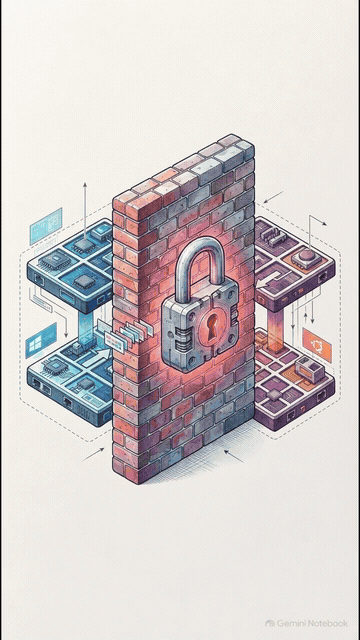
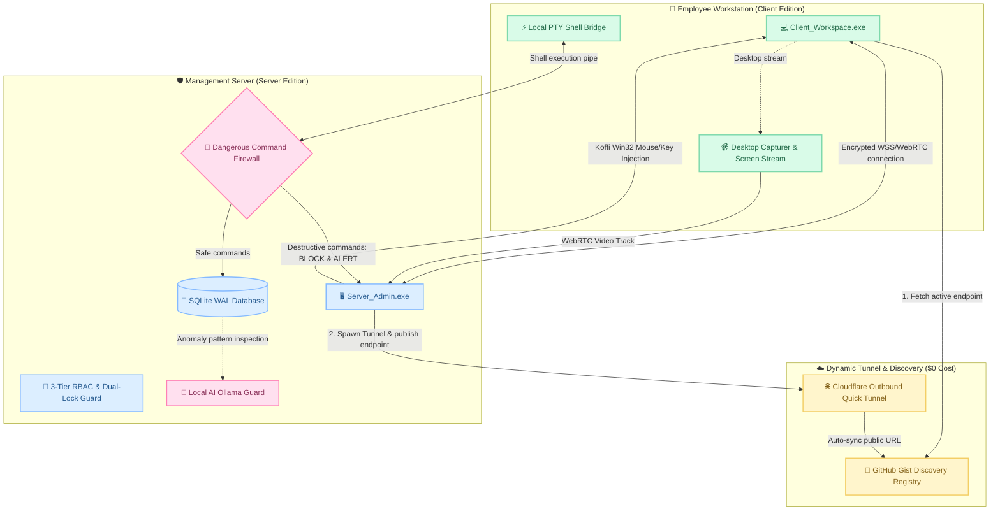

<div align="center">


### 🛡️ Enterprise Zero-Trust Remote Workspace & Audited Desktop System
*High-performance remote management suite featuring UltraViewer-style low-latency desktop control, audited web-based SSH terminal with an active Command Firewall, and self-healing P2P cross-network discovery with $0 infrastructure cost.*

<br/>

[](https://github.com/phanleon/Gr_2/stargazers)
[](https://github.com/phanleon/Gr_2/network/members)
[](https://github.com/phanleon/Gr_2)
[](https://github.com/phanleon/Gr_2)
[](https://github.com/phanleon/Gr_2)
[](https://github.com/phanleon/Gr_2)

<br/>

<a href="https://git.io/typing-svg">
  
</a>

<br/>

> 🌟 **If you find this project valuable, please give it a Star ⭐ in the top right corner to support open-source development!** 🌟

`🛡️` ━━━━━━━━━━━━━━━━━━━━━━━━━━━━━━━━━━━━━━━━━━━━━━━━━━━━━━━━━━━━━━━━━━━━━━━━ `🛡️`

</div>

## 📌 Table of Contents

- [🌟 Overview](#-overview)
- [🎬 Video Demo & Operational Mechanics](#-video-demo--operational-mechanics)
- [✨ Key Features](#-key-features)
- [🔄 Security Architecture](#-security-architecture)
- [🚀 Quick Start Guide](#-quick-start-guide)
- [🔐 Default Credentials](#-default-credentials)
- [📂 Project Structure](#-project-structure)
- [🤖 Local AI Copilot Integration](#-local-ai-copilot-integration)

---

## 🌟 Overview

**Secure Remote Workspace** is a unified desktop enterprise solution built on **Electron, React 18, Express, SQLite (WAL mode), and TypeScript**. It enables seamless and secure cross-network collaboration across isolated endpoints (home Wi-Fi, public hotspots, mobile 4G/5G, and enterprise CGNAT networks) with **Zero Router Configuration (No port forwarding needed)** and **$0 server infrastructure costs**.

### Core Pillars:
1. **Zero-Trust Security Model:** Never trust, always verify. Every department room enforces Dual-Lock verification: room password authentication combined with mandatory Room Owner or Administrator authorization.
2. **Proactive Command Firewall:** Inspects incoming shell streams in real-time, instantly blocking destructive commands (`rm -rf`, `format`, `Remove-Item -Force`, `reg delete`) before execution on client workstations.
3. **Native Desktop Remote Control:** Ultra-low-latency WebRTC desktop streaming coupled with native Win32 `user32.dll` input injection via high-performance FFI (`koffi`), featuring an emergency **`F12`** panic cutoff switch.

---

## 🎬 Video Demo & Operational Mechanics

Watch the visual demonstration explaining **How Cross-Network Internet & LAN Routing Operates via Secure Reverse SSH Tunneling**:

<div align="center">

### 📺 Video: Cross-Network Routing & Zero-Trust Reverse SSH Tunneling

<a href="https://github.com/phanleon/Gr_2/blob/main/docs/videos/Cach_InternetLAN_Van_Hanh_Duong_Ham_SSH.mp4" title="Click to watch full high-definition video with audio on GitHub">
  
</a>

<br/>
<br/>

[](https://github.com/phanleon/Gr_2/blob/main/docs/videos/Cach_InternetLAN_Van_Hanh_Duong_Ham_SSH.mp4)

<br/>

> 💡 *The animated demonstration plays automatically above! Click on the animation or the badge above to watch the complete Full HD video with audio directly in GitHub's web player without downloading.*

</div>

#### 📌 Core Mechanics Covered in the Video:
1. **NAT, CGNAT & Firewall Traversal:** Why devices located on disparate private local networks cannot establish direct incoming connections without open router ports.
2. **Zero-Trust Reverse Tunneling:** The client initiates an encrypted outbound connection to an intermediary tunnel gateway, bypassing all restrictive NAT and firewall policies cleanly.
3. **End-to-End Encryption & Keystroke Auditing:** Full packet protection with comprehensive audit trails, paired with an active firewall neutralizing malicious commands before hitting the kernel.

---

## ✨ Key Features

| Icon | Feature | Technical Details |
|:---:|:---|:---|
| 🌐 | **Zero-Config Discovery ($0)** | Outbound Cloudflare Quick Tunnels (`*.trycloudflare.com`) synchronized with GitHub Gist discovery registry. Dynamic reconnection and self-healing within 5 seconds upon IP/Wi-Fi transitions. |
| 🖥️ | **UltraViewer-Style Desktop** | Real-time WebRTC desktop screen sharing with JPEG fallback over WebSocket. Sub-millisecond mouse and keyboard event injection powered by `koffi` (`user32.dll`). Emergency kill-switch on **`F12`**. |
| 🛡️ | **Zero-Trust WebTerminal & SSH** | Integrated `xterm.js` terminal allowing authorized administrators to execute remote shell diagnostics **without exposing Port 22**. Every keystroke is logged directly into the Server audit store. |
| 🛑 | **Dangerous Command Firewall** | Real-time heuristic parsing that neutralizes destructive patterns (`del /f /s /q`, `Remove-Item C:\`, `reg delete`, `mkfs`) and broadcasts immediate `CRITICAL` alarms to the Server dashboard. |
| 🏢 | **Department Room Isolation** | Role-Based Access Control (RBAC) departmental hubs (IT, Finance, Marketing, Operations). Strictly segregated feeds, vaults, and task workflows accessible only to authenticated personnel. |
| 📦 | **10MB Chunked File Transfer** | Automatic file chunking into 10MB fragments to comply with free tunnel payload thresholds, reassembled at the destination with SHA-256 cryptographic verification. |
| 🤖 | **On-Premise AI Copilot (Ollama)** | Native local LLM connectivity for automated meeting recaps, project task generation, and natural language command synthesis (`#ai <prompt>` translated to valid PowerShell/Bash). |

---

## 🔄 Security Architecture



---

## 🚀 Quick Start Guide

### Prerequisites:
- Operating System: **Windows 10 / 11** (Linux supported).
- Runtime: **[Node.js (LTS Version)](https://nodejs.org/)** (v18 or v20+ recommended).

---

### Method 1: 1-Click Launch on Windows (Recommended ⭐)

1. Download the repository source: Click **Code > Download ZIP** on GitHub and extract the folder.
2. Initialize and start the application automatically by double-clicking:
   ```text
   INSTALL_AND_RUN.bat
   ```
   *This automated script checks prerequisites, runs `npm install`, and opens the workspace.*
3. Launch specific editions independently:
   * **Start Server Administration Edition:** Double-click `RUN_SERVER.bat` (or run `npm run electron:server`).
   * **Start Client Workstation Edition:** Double-click `RUN_CLIENT.bat` (or run `npm run electron:client`).

---

### Method 2: Launch via Terminal

```bash
# 1. Clone the repository
git clone https://github.com/phanleon/Gr_2.git
cd Gr_2

# 2. Install all required dependencies
npm install

# 3. Start the Vite React development server
npm run dev

# 4. Launch both Server & Client instances concurrently
npm run dev:both:electron
```

---

### Method 3: Standalone Portable Binary (No Node.js Required)
Located under the `dist-release/` directory:
* [**`dist-release/SecureWorkspace_Portable.exe`**](dist-release/SecureWorkspace_Portable.exe) (~103 MB) — Double-click to execute immediately without installing dependencies!

---

## 🔐 Default Credentials

The system initializes with a root administrative account:

| Role | Username | Default Password | Privileges |
|:---|:---:|:---:|:---|
| **SERVER_ADMIN (Root)** | `admin` | `Server@123456` | Full administrative control: room provisioning, access approvals, audit log inspection, and remote desktop takeover. |
| **ROOM_OWNER** | *Created via Dashboard* | *Configurable* | Department room administration: member access approval, kick, and audio moderation. |
| **CLIENT** | *Created via Dashboard* | *Configurable* | Workstation user: room participation, messaging, WebRTC calling, and authorized screen sharing. |

---

## 📂 Project Structure

```text
Gr_2/
├── dist/                              # Compiled production HTML/CSS/JS assets
│   ├── assets/
│   │   ├── index-BNDu8XHC.js          # Core frontend bundle
│   │   └── index-BwycqhT4.css         # Tailwind styles bundle
│   └── index.html                     # Frontend entrypoint
├── dist-electron/                     # Transpiled backend & Electron main processes
│   ├── electron/                      # Main process & native Win32 FFI bridges
│   └── server/                        # Express API, Socket.io & SQLite DB
├── dist-release/                      # Packaged standalone distribution binaries
│   └── SecureWorkspace_Portable.exe   # Portable 1-Click executable
├── docs/                              # Project documentation & media assets
│   └── videos/                        # Architecture explainer videos & animations
│       ├── Cach_InternetLAN_Van_Hanh_Duong_Ham_SSH.mp4
│       └── demo.gif
├── electron/                          # Electron source code in TypeScript
│   ├── main.ts                        # Main process entry (Server/Client mode selector)
│   └── services/                      # Watchdog, Win32 input injection, SSH PTY
├── server/                            # Backend source code in TypeScript
│   ├── controllers/                   # Room management, user auth, vault storage
│   ├── db/                            # SQLite schema definitions & database DAO
│   ├── middleware/                    # JWT authentication & audit interceptors
│   └── sockets/                       # WebRTC signaling, chat, and SSH terminal sockets
├── src/                               # React 18 frontend source code
│   ├── components/                    # Dashboard, Lobby, Vault, Whiteboard, Feeds
│   ├── context/                       # Socket & Authentication state management
│   └── main.tsx                       # React application mountpoint
├── INSTALL_AND_RUN.bat                # 1-Click setup and launcher for Windows
├── RUN_SERVER.bat                     # 1-Click launcher for Server Edition
├── RUN_CLIENT.bat                     # 1-Click launcher for Client Edition
├── package.json                       # Project metadata & dependencies
├── tsconfig.electron.json             # TypeScript configuration for Electron
├── vite.config.ts                     # Vite bundler configuration
└── README.md                          # Official project documentation
```

---

## 🤖 Local AI Copilot Integration

Secure Remote Workspace integrates out-of-the-box with **[Ollama](https://ollama.com/)** running locally (`http://127.0.0.1:11434`):
* **Meeting & Plan Summarization:** Click the *AI Summary* action on any departmental post to extract key action items into concise bullet points.
* **AI SSH Copilot:** Inside the web terminal, type `#ai <prompt>` (e.g., `#ai check listening network ports`) to synthesize validated PowerShell or Bash syntax.
* **AI Security Watchdog:** Continuously analyzes `audit_logs` to flag anomalous authentication attempts or unauthorized traversal vectors.

<br/>

<div align="center">
  
</div>
