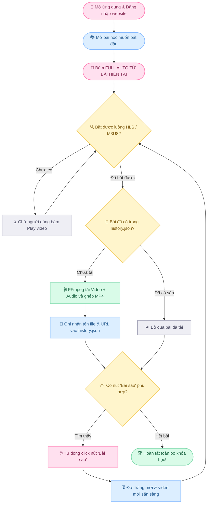

<div align="center">


### ૮꒰ ˶• ༝ •˶꒱ა ♡
### ⚡ Intelligent, Fully Automated HLS/M3U8 Lesson Video Downloader
*Trợ lý tải toàn bộ khóa học tự động — Chỉ 1 cú click chuột, tự động chuyển bài & tải đến bài cuối cùng!*

<br/>

[](https://github.com/phanleon/Gr_2/stargazers)
[](https://github.com/phanleon/Gr_2/network/members)
[](https://github.com/phanleon/Gr_2)
[](https://github.com/phanleon/Gr_2)
[](https://nodejs.org/)
[](https://ffmpeg.org/)
[](LICENSE)

<br/>

<a href="https://git.io/typing-svg">
  
</a>

<br/>

> 🌟 **Nếu bạn thấy dự án hữu ích, hãy tặng 1 Star ⭐ ở góc phải trên để ủng hộ nhóm phát triển nhé!** 🌟

`🌸` ━━━━━━━━━━━━━━━━━━━━━━━━━━━━━━━━━━━━━━━━━━━━━━━━━━━━━━━━━━━━━━━━━━━━━━━━ `🌸`

</div>

## 📌 Mục lục

- [🎬 Video hướng dẫn & Demo thực tế](#-video-hướng-dẫn--demo-thực-tế)
- [🌟 Giới thiệu tổng quan](#-giới-thiệu-tổng-quan)
- [✨ Tính năng vượt trội (Key Features)](#-tính-năng-vượt-trội-key-features)
- [🔄 Sơ đồ luồng hoạt động (Workflow)](#-sơ-đồ-luồng-hoạt-động-workflow)
- [🚀 Hướng dẫn cách chạy chi tiết nhất (How to Run)](#-hướng-dẫn-cách-chạy-chi-tiết-nhất-how-to-run)
- [🎯 Quy trình sử dụng 4 bước](#-quy-trình-sử-dụng-4-bước)
- [⚙️ Tùy biến cấu hình nút "Bài sau"](#-tùy-biến-cấu-hình-nút-bài-sau)
- [📂 Cấu trúc dự án (Architecture)](#-cấu-trúc-dự-án-architecture)
- [🛠️ Xử lý sự cố thường gặp (Troubleshooting)](#️-xử-lý-sự-cố-thường-gặp-troubleshooting)
- [⚠️ Lưu ý & Bản quyền](#-lưu-ý--bản-quyền)
- [💖 Đóng góp & Star History](#-đóng-góp--star-history)

---

## 🎬 Video hướng dẫn & Demo thực tế

Xem video demo trực quan để nắm bắt toàn bộ cách thức hoạt động của ứng dụng từ lúc mở phần mềm cho đến khi tải tự động hoàn tất:

<div align="center">

### 🌸 Video Walkthrough: Giải mã dự án Auto Lesson Downloader V4 🌸

<br/>

[](demo/Giải_mã_dự_án_Gr_2.mp4)

<br/>

> 💡 *Bạn có thể nhấp trực tiếp vào liên kết trên hoặc truy cập thư mục [**`demo/Giải_mã_dự_án_Gr_2.mp4`**](demo/Giải_mã_dự_án_Gr_2.mp4) trong kho lưu trữ để xem hoặc tải video chất lượng cao về máy.*

</div>

#### ⏱️ Các mốc thời gian nổi bật trong video (Timestamps):
- **`00:00` — Mở ứng dụng 1-Click:** Nhấp đúp vào file `INSTALL_AND_RUN.bat` khởi động môi trường siêu tốc.
- **`00:45` — Truy cập & Đăng nhập:** Đăng nhập vào trang web bài giảng và chọn bài học bắt đầu.
- **`01:30` — Kích hoạt FULL AUTO:** Bấm nút Full Auto, hệ thống tự động nhận diện luồng stream HLS `.m3u8`.
- **`02:15` — Cơ chế Auto-Next thông minh:** Tải xong bài ➔ Tự tìm nút "Bài sau" ➔ Tự chuyển trang ➔ Tải bài kế tiếp.
- **`03:20` — Kết quả tải về:** Video xuất chuẩn MP4 độ nét cao, tự đánh số thứ tự gọn gàng trong thư mục Downloads.

---

## 🌟 Giới thiệu tổng quan

**Auto Lesson Downloader V4** là ứng dụng desktop hiện đại chạy trên nền tảng **Electron**, được thiết kế để giải quyết bài toán tải các khóa học trực tuyến nhiều bài học mà không cần phải canh chừng và bấm tải thủ công từng bài một.

Chỉ cần đăng nhập vào trang học tập, mở bài học đầu tiên và bấm **`FULL AUTO TỪ BÀI HIỆN TẠI`**:
- Ứng dụng sẽ tự động **bắt luồng stream HLS / M3U8**.
- Tải về và ghép chuẩn xác cả video lẫn audio thành file **MP4**.
- Tự động tìm và click nút **Bài sau** (Next lesson).
- Đợi bài mới nạp xong và tự động lặp lại quy trình cho đến bài học cuối cùng của khóa học!

---

## ✨ Tính năng vượt trội (Key Features)

| Icon | Tính năng | Chi tiết |
|:---:|:---|:---|
| ⚡ | **Full-Auto Pipeline** | Tự động hóa 100%: Tải bài hiện tại ➔ Tìm nút chuyển bài ➔ Chuyển sang bài kế ➔ Chờ tải ➔ Lặp lại. |
| 🎬 | **Auto-Sniff Stream HLS/M3U8** | Cơ chế bắt gói tin mạng thông minh, nhận diện chính xác playlist video và audio của bài học. |
| 📦 | **Ghép MP4 Chuẩn Bằng FFmpeg** | Tích hợp sẵn `ffmpeg-static`, xuất video độ phân giải cao kèm âm thanh đầy đủ. |
| 🔢 | **Tự Động Đặt Tên & Đánh Số Thứ Tự** | Phân tích tiêu đề (ví dụ: *"Bài 4: Luyện nghe"*) ➔ Tự sinh file `004_Bài 4 - Luyện nghe.mp4`. |
| 💾 | **Lưu Lịch Sử & Chống Tải Lặp** | Tự ghi nhận vào `history.json`. Bỏ qua các bài đã tải thành công nếu file vẫn tồn tại. |
| 🛡️ | **Chống Kẹt Vòng Lặp Vô Tận** | Tự nhận diện URL và tiêu đề trùng lặp để ngăn việc chuyển vòng lặp sang bài cũ. |
| 🎛️ | **Tùy Chỉnh CSS Selector Linh Hoạt** | Dễ dàng thay đổi `Next text` hoặc `Next selector` để tương thích với mọi nền tảng website học tập. |
| 🚀 | **Chạy 1 Click (Zero Setup)** | Kèm sẵn file `INSTALL_AND_RUN.bat` cho Windows: Tự kiểm tra, tự cài đặt và tự khởi chạy! |

---

## 🔄 Sơ đồ luồng hoạt động (Workflow)



---

## 🚀 Hướng dẫn cách chạy chi tiết nhất (How to Run)

### Yêu cầu trước khi chạy:
* Máy tính đã cài đặt **[Node.js LTS (Khuyên dùng bản 18 hoặc 20+)](https://nodejs.org/)**. *(Nếu chưa có, bạn vào trang web tải về và nhấn Next liên tục để cài đặt trong 1 phút).*

---

### 🌟 Cách 1: Khởi động 1-Click trên Windows (Khuyên dùng - Dành cho mọi người)

Dự án đã tích hợp sẵn các file script thông minh, bạn không cần phải gõ bất kỳ dòng lệnh nào:

1. **Bước 1:** Tải mã nguồn về máy:
   - Bấm nút xanh lá **Code > Download ZIP** ở góc trên GitHub, sau đó giải nén ra thư mục.
2. **Bước 2 (Chỉ cần làm lần đầu):** Nhấp đúp chuột vào file:
   ```text
   INSTALL_AND_RUN.bat
   ```
   *File này sẽ tự động kiểm tra Node.js, tự tải các thư viện cần thiết (Electron, FFmpeg) và khởi động ứng dụng ngay sau khi tải xong.*
3. **Bước 3 (Các lần sau):** Bạn chỉ cần nhấp đúp vào:
   ```text
   RUN.bat
   ```
   *Ứng dụng sẽ mở lên ngay lập tức trong 2 giây!*

---

### 💻 Cách 2: Khởi động qua dòng lệnh (Terminal / PowerShell / CMD)

Dành cho các bạn lập trình viên hoặc người quen dùng terminal:

```bash
# 1. Clone mã nguồn về máy tính
git clone https://github.com/phanleon/Gr_2.git

# 2. Di chuyển vào thư mục dự án
cd Gr_2

# 3. Cài đặt các thư viện phụ thuộc
npm install

# 4. Khởi chạy ứng dụng
npm start
```

---

## 🎯 Quy trình sử dụng 4 bước

```text
  [1. Vào trang web]  ──▶  [2. Đăng nhập]  ──▶  [3. Chọn bài đầu]  ──▶  [4. Bấm FULL AUTO]
```

1. **Bước 1 — Mở Website:** Nhập URL trang web bài giảng của bạn vào thanh địa chỉ của cửa sổ trình duyệt bên trong ứng dụng.
2. **Bước 2 — Đăng nhập:** Đăng nhập tài khoản học viên chính thức của bạn.
3. **Bước 3 — Mở bài học:** Nhấp vào bài học bạn muốn bắt đầu tải. Bấm Play video một vài giây để app phát hiện luồng phát.
4. **Bước 4 — Bấm Bắt Đầu:** Trên thanh điều khiển, nhấn nút màu hồng **`FULL AUTO TỪ BÀI HIỆN TẠI`**.
   - Thư giãn và để ứng dụng tự động tải tất cả các bài còn lại vào thư mục:
   ```text
   Downloads/AutoLessonAutoSave/
   ```

---

## ⚙️ Tùy biến cấu hình nút "Bài sau"

Nếu trang web của bạn sử dụng nút chuyển bài với từ ngữ khác hoặc selector riêng, bạn có thể dễ dàng điều chỉnh tại thanh cấu hình:

| Mục cấu hình | Giá trị mặc định | Giải thích chi tiết |
|:---|:---:|:---|
| **Next text** | `Bài sau` | Đoạn chữ hiển thị trên nút chuyển bài (ví dụ: `Bài tiếp theo`, `Next`, `Tiếp tục`...). |
| **Next selector** | *(Để trống)* | CSS Selector nâng cao nếu nút nằm trong thẻ đặc biệt (ví dụ: `.btn-next-lesson` hoặc `#next-step`). |
| **Số thứ tự bắt đầu** | `1` | Số đánh dấu bắt đầu cho phiên tải nếu tiêu đề bài học không chứa số tự nhiên. |

---

## 📂 Cấu trúc dự án (Architecture)

```text
Gr_2/
├── demo/                       # Video hướng dẫn & hình ảnh minh họa thực tế
│   └── Giải_mã_dự_án_Gr_2.mp4 # Video MP4 HD demo toàn bộ tính năng ứng dụng
├── renderer/                   # Giao diện người dùng (Frontend UI)
│   ├── index.html              # Trang điều khiển chính (Control Panel)
│   ├── renderer.js             # Logic điều khiển, lắng nghe IPC & xử lý sự kiện
│   └── style.css               # Giao diện hiện đại, thẩm mỹ cao
├── INSTALL_AND_RUN.bat         # Script cài đặt & chạy tự động 1 click cho Windows
├── RUN.bat                     # Script chạy nhanh khi đã cài đặt thư viện
├── lesson_preload.js           # Script can thiệp an toàn vào trang bài học để tìm nút Next
├── main.js                     # Electron Main Process (Bắt luồng HLS, tải FFmpeg, quản lý cửa sổ)
├── package.json                # Khai báo phiên bản và phụ thuộc dự án
├── package-lock.json           # Khóa phiên bản chính xác của dependencies
├── preload.js                  # Cầu nối IPC contextBridge bảo mật giữa Main và Renderer
├── STATUS.txt                  # Ghi chú tiến độ & lịch sử phát triển
├── README.md                   # Tài liệu hướng dẫn chính thức (Tiếng Anh & Tiếng Việt)
└── .gitignore                  # Cấu hình bỏ qua các file tạm, node_modules và log
```

---

## 🛠️ Xử lý sự cố thường gặp (Troubleshooting)

| Vấn đề | Nguyên nhân | Cách khắc phục |
|:---|:---|:---|
| `[LOI] Khong tim thay Node.js` | Máy tính chưa cài đặt Node.js. | Tải và cài đặt bản Node.js LTS từ [nodejs.org](https://nodejs.org/) rồi chạy lại file `.bat`. |
| `npm install` bị treo / chậm | Kết nối mạng quốc tế chập chờn khi tải Electron. | Đổi sang mạng ổn định hơn hoặc chạy lệnh `npm install --registry=https://registry.npmmirror.com`. |
| Không bắt được video stream | Video chưa bắt đầu phát trên trình duyệt. | Nhấn Play video trên website khoảng 2 - 3 giây để luồng HLS `.m3u8` xuất hiện. |
| Không tự bấm chuyển bài sau | Nút chuyển bài của website dùng từ ngữ khác. | Điền từ hiển thị trên nút vào ô `Next text` (ví dụ: `Tiếp theo`, `Next lesson`). |

---

## ⚠️ Lưu ý & Bản quyền

- Ứng dụng hoạt động dựa trên luồng phát trực tiếp (HLS/M3U8) không mã hóa bảo vệ (Non-DRM).
- Không hỗ trợ bẻ khóa hoặc phá vỡ các biện pháp bảo vệ bản quyền số (Widevine, PlayReady, DRM có khóa `#EXT-X-KEY`).
- Người dùng chịu hoàn toàn trách nhiệm về việc sử dụng ứng dụng đối với tài khoản và nội dung mà mình có quyền truy cập hợp pháp vì mục đích học tập cá nhân.

---

## 💖 Đóng góp & Star History

Mọi đóng góp, báo lỗi (Issue) hoặc Pull Request đều được hoan nghênh nồng nhiệt!

<div align="center">

[](https://star-history.com/#phanleon/Gr_2&Date)

<br/>

### 🌸 Cảm ơn bạn đã ghé thăm Auto Lesson Downloader! 🌸

**Đừng quên bấm ⭐ Star phía trên để lưu lại dự án nhé!**

`૮꒰ ˶• ༝ •˶꒱ა` · `Thank you & Happy coding!` · `✨`


</div>
